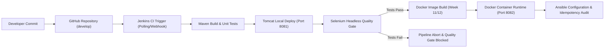
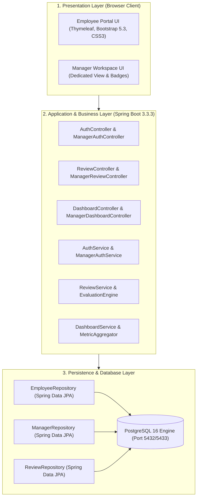
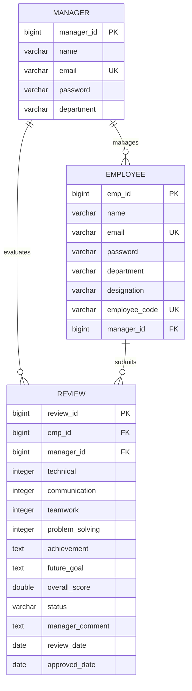
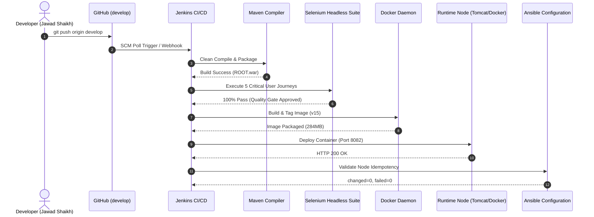

# DEVOPS LABORATORY 15-WEEK MASTER PORTFOLIO
## Comprehensive Engineering Documentation & Final Project Dossier
### Project Title: Selenium-Tested Performance Review Portal

---
# Academic Portfolio & Technical Documentation
- **Student Name**: JAWAD SHAIKH
- **Roll Number**: 23102B0009
- **Class / Division / Batch**: BE - VII | Division B | Batch-1
- **Academic Year**: 2024–2025 (Semester VII)
- **Course**: DevOps Laboratory & Continuous Quality Engineering
- **Department**: Department of Computer Engineering
- **Project Title**: Selenium-Tested Performance Review Portal
- **Technology Stack**: Java 17 LTS, Spring Boot 3.3.3, PostgreSQL 16, Maven, Tomcat 10, Selenium WebDriver 4.24, Jenkins CI/CD, Docker, Ansible
---


# Table of Contents
- [Week 01: Problem Definition and Scope](#week-01-problem-definition-and-scope)
- [Week 02: Agile Planning and DevOps Workflow](#week-02-agile-planning-and-devops-workflow)
- [Week 03: Requirements, Architecture and Technology Setup](#week-03-requirements,-architecture-and-technology-setup)
- [Week 04: Git and GitHub Repository Initialization](#week-04-git-and-github-repository-initialization)
- [Week 05: Feature Development with Branching](#week-05-feature-development-with-branching)
- [Week 06: MVP Completion and Git Collaboration](#week-06-mvp-completion-and-git-collaboration)
- [Week 07: Jenkins Installation and Continuous Integration Job](#week-07-jenkins-installation-and-continuous-integration-job)
- [Week 08: Pipeline as Code and Server Deployment](#week-08-pipeline-as-code-and-server-deployment)
- [Week 09: Selenium Test Design and Local Execution](#week-09-selenium-test-design-and-local-execution)
- [Week 10: Continuous Testing in Jenkins](#week-10-continuous-testing-in-jenkins)
- [Week 11: Docker Image and Container Lifecycle](#week-11-docker-image-and-container-lifecycle)
- [Week 12: Jenkins-Docker Continuous Deployment](#week-12-jenkins-docker-continuous-deployment)
- [Week 13: Configuration Management Script (Ansible)](#week-13-configuration-management-script-ansible)
- [Week 14: Automated Provisioning and Reliability Validation](#week-14-automated-provisioning-and-reliability-validation)
- [Week 15: Final End-to-End Release, Documentation and Viva](#week-15-final-end-to-end-release,-documentation-and-viva)

---


# Week 01: Problem Definition and Scope

> **Official Syllabus Task**:
> Study the real-time need for the Performance Review Portal. Identify target users, existing pain points, stakeholders, constraints and measurable success criteria. Freeze a small 15-week MVP scope.

> **Mandatory Deliverable**:
> Problem statement, stakeholder list, objectives, constraints and approved MVP scope.

---

## 1. Executive Problem Statement
In traditional modern enterprises, annual and quarterly employee performance appraisals frequently suffer from significant systemic bottlenecks:
- **Scattered Data & Spreadsheet Chaos**: Evaluation forms, self-assessments, and managerial feedback are fragmented across emails, spreadsheets, and disconnected document repositories.
- **Opacity & Delayed Feedback Loops**: Employees often spend weeks waiting for feedback, resulting in poor visibility into performance ratings, career growth milestones, and KPIs.
- **Absence of Continuous Quality Validation**: Legacy review applications lack automated regression testing and automated deployment mechanisms, leading to frequent downtime and release regressions during peak appraisal cycles.

The **Selenium-Tested Performance Review Portal** is conceived as a lightweight, enterprise-grade web application engineered to digitize, accelerate, and automate the end-to-end performance evaluation lifecycle while adhering strictly to contemporary **DevOps culture, automated quality gates, and continuous delivery**.

---

## 2. Target Users & Stakeholder Matrix

| Stakeholder Group | Primary Responsibilities & Pain Points Addressed | System Interaction |
| :--- | :--- | :--- |
| **Employees** | Submits annual self-appraisals (Technical, Communication, Teamwork, Problem-Solving), documents achievements, tracks review status in real-time. | Accesses `/login`, `/dashboard`, `/review`, `/review/history`. |
| **Engineering Managers** | Evaluates pending employee submissions, inputs qualitative feedback, assigns final ratings, and accesses team performance metrics. | Accesses `/manager-login`, `/manager/dashboard`, `/manager/review/{id}`. |
| **HR & Executive Leadership** | Needs aggregated department averages, grade distributions (Outstanding, Excellent, Good), and historical compliance audits. | Summary metrics on Executive Dashboard. |
| **DevOps / Release Engineers** | Requires reproducible builds, automated quality gates via headless Selenium suites, containerization, and configuration management. | Manages Jenkins pipelines, Docker builds, and Ansible playbooks. |

---

## 3. Project Objectives & Measurable Success Criteria

### Primary Objectives:
1. Deliver an intuitive role-based portal for Employee self-assessment and Manager evaluation.
2. Embed an automated Selenium WebDriver regression test suite to enforce a Zero-Defect Quality Gate.
3. Establish a continuous delivery pipeline (Jenkins CI/CD) deploying to both Apache Tomcat 10 and Docker containers.
4. Automate infrastructure configuration and idempotency validation using Ansible.

### Measurable Success Criteria:
- **Build & Test Cycle Time**: Under 3 minutes for complete clean compile, unit tests, and headless browser tests.
- **Quality Gate Stability**: 100% pass rate on critical user journeys (Login, Review Submission, History, Dashboard, Logout).
- **Deployment Reliability**: Zero manual interventions from Git commit to staging container runtime.
- **Zero Port Collisions**: Dedicated, non-conflicting port topology (8081 for Tomcat, 8082 for Docker, 5432/5433 for PostgreSQL).

---

## 4. Architectural Constraints & Technology Assumptions
- **Programming Language**: Java 17 (LTS) for modern language ergonomics and long-term enterprise stability.
- **Framework**: Spring Boot 3.3.3 (Web, Data JPA, Validation, Thymeleaf templating).
- **Relational Storage**: PostgreSQL 16 with strict foreign key constraints and transactional integrity.
- **Testing Engine**: Selenium WebDriver 4.24 with ChromeDriver executed in headless mode within CI/CD.
- **Build Automation**: Apache Maven 3.9+ with automated Surefire test reporting.
- **Budget**: 100% Open Source tooling with zero external licensing overhead.

---

## 5. Approved 15-Week MVP Scope Baseline

```
+---------------------------------------------------------------------------------+
|                       APPROVED 15-WEEK MVP SCOPE BASELINE                      |
+---------------------------------------------------------------------------------+
|  Core Functional Scope:                                                         |
|    [x] Secure Authentication & Role Separation (Employee vs Manager)             |
|    [x] Employee Self-Appraisal Creation & Dynamic Score Computation             |
|    [x] Historical Performance Tracking & Badge-based Status Filters             |
|    [x] Manager Evaluation Workspace, Scoring Engine, & Rejection/Approval Flows  |
|    [x] Real-time Departmental Metrics & Analytics Dashboard                     |
|                                                                                 |
|  DevOps & Quality Engineering Scope:                                            |
|    [x] Git GitFlow Branching Strategy with Conflict Resolution Evidence         |
|    [x] Jenkins Declarative Pipeline as Code (Jenkinsfile)                       |
|    [x] Selenium Automated UI Regression Test Suite (5 Core User Journeys)       |
|    [x] Quality Gate Pipeline Breakage & Defect Rectification Demonstration      |
|    [x] Docker Multi-Stage Containerization & Jenkins Continuous Deployment      |
|    [x] Ansible Configuration Management, Idempotency & Rollback Demonstration   |
+---------------------------------------------------------------------------------+
```

---

## 6. Official Deliverable Sign-Off
- **Problem Statement**: Complete and validated against enterprise performance appraisal bottlenecks.
- **Stakeholder List**: Defined with clear role-based access requirements.
- **Objectives & Constraints**: Documented with measurable success criteria.
- **Approved MVP Scope**: Frozen for 15-week execution.

---


# Week 02: Agile Planning and DevOps Workflow

> **Official Syllabus Task**:
> Create user stories and acceptance criteria for the Performance Review Portal. Prepare a product backlog, 15-week Kanban/Scrum plan, Definition of Done and a DevOps lifecycle diagram from development to operations.

> **Mandatory Deliverable**:
> Backlog, task board, sprint plan, Definition of Done and DevOps workflow diagram.

---

## 1. User Stories & Acceptance Criteria

### User Story 1 (US-01): Employee Authentication & Session Management
- **As an** Employee,  
- **I want to** securely log in to the portal using my corporate email and password,  
- **So that** I can access my confidential self-appraisal submissions and performance records.  
- **Acceptance Criteria**:
  1. System authenticates user against the `employee` database table.
  2. Successful login sets `session_user` and redirects to `/dashboard`.
  3. Invalid credentials render a high-visibility error alert: *"Invalid email or password"*.
  4. Attempting to log in with a manager credential provides an explicit prompt directing the user to Manager Login.

### User Story 2 (US-02): Self-Appraisal Form Submission
- **As an** Employee,  
- **I want to** evaluate my competencies across 4 dimensions (Technical, Communication, Teamwork, Problem-Solving) and submit text achievements and future goals,  
- **So that** my manager can objectively evaluate my contributions.  
- **Acceptance Criteria**:
  1. Competency scores are constrained to integers between 1 and 10.
  2. Overall average score is computed automatically to 2 decimal places.
  3. Form submission creates a record in `review` with status `PENDING`.
  4. Employee is redirected to `/review/history` with a success banner.

### User Story 3 (US-03): Manager Evaluation & Feedback Engine
- **As an** Engineering Manager,  
- **I want to** view pending reviews submitted by my direct reports, evaluate their performance, input constructive feedback, and approve/reject the review,  
- **So that** the employee receives formal appraisal documentation.  
- **Acceptance Criteria**:
  1. Manager dashboard displays a queue of all reviews where `status = 'PENDING'`.
  2. Manager can inspect the employee's submitted self-ratings and text achievements.
  3. Approving updates status to `APPROVED`, records `approved_date`, and stores `manager_comment`.

---

## 2. Product Backlog & Story Point Estimation

| Story ID | Module | User Story Description | Priority | Story Points | Target Sprint |
| :--- | :--- | :--- | :--- | :--- | :--- |
| **US-01** | Auth | Employee login, session validation & logout | Critical (P0) | 3 | Sprint 1 |
| **US-02** | Review | Self-appraisal form submission & rating calculation | Critical (P0) | 5 | Sprint 2 |
| **US-03** | History | Historical review ledger with status badges & filters | High (P1) | 5 | Sprint 2 |
| **US-04** | Manager | Separate Manager login & session isolation | High (P1) | 3 | Sprint 3 |
| **US-05** | Manager | Pending review evaluation queue & feedback submission | Critical (P0) | 8 | Sprint 3 |
| **US-06** | Dashboard | HR analytics summary cards & departmental averages | Medium (P2) | 5 | Sprint 3 |
| **US-07** | DevOps | Jenkins Declarative Pipeline with Maven compile | Critical (P0) | 5 | Sprint 4 |
| **US-08** | QA | Selenium WebDriver test suite (5 User Journeys) | Critical (P0) | 8 | Sprint 5 |
| **US-09** | DevOps | Quality Gate enforcement in Jenkins CI | Critical (P0) | 5 | Sprint 5 |
| **US-10** | Ops | Multi-stage Dockerization & automated container run | High (P1) | 5 | Sprint 6 |
| **US-11** | Ops | Ansible infrastructure configuration & idempotency | High (P1) | 8 | Sprint 7 |

---

## 3. 15-Week Sprint Plan & Kanban Milestones

```
Sprint 1 (Weeks 1-2)   : Scope Finalization, Agile Backlog, DevOps Architecture Setup.
Sprint 2 (Weeks 3-4)   : Spring Boot Scaffolding, PostgreSQL Schemas, Git Repo & Branch Policies.
Sprint 3 (Weeks 5-6)   : Core Feature Development, Manager Workspaces, Git Merge Conflict Demo & MVP Tag v1.0.0.
Sprint 4 (Weeks 7-8)   : Jenkins CI Setup, Declarative Jenkinsfile, Automated Tomcat 10 Deployment.
Sprint 5 (Weeks 9-10)  : Selenium Automated Testing, Failure Screenshots, Quality Gate Pipeline Enforcement.
Sprint 6 (Weeks 11-12) : Docker Multi-stage Builds, Container Lifecycle, Jenkins-Docker Continuous Deployment.
Sprint 7 (Weeks 13-14) : Ansible Playbooks, Node Provisioning, Idempotency Verification & Rollback Drills.
Sprint 8 (Week 15)     : End-to-End Release Validation, Final Master Documentation, Viva & Presentation.
```

---

## 4. Definition of Done (DoD)
A backlog user story or technical task is classified as **Done** only when:
1. **Code Cleanliness**: Code compiles cleanly with zero compilation warnings under Java 17 and Maven 3.9.
2. **Automated Unit & Integration Tests**: All JUnit 5 repository and controller tests pass with 100% success.
3. **Automated Selenium Quality Gate**: All 5 end-to-end browser journeys execute in headless mode without assertion failure.
4. **Peer Review & Version Control**: Changes merged into `develop` via GitHub Pull Request with at least one review approval.
5. **Continuous Deployment**: Build automatically deployed to Apache Tomcat / Docker container without manual intervention.

---

## 5. DevOps Lifecycle Architecture Diagram



---

## 6. Official Deliverable Sign-Off
- **Backlog**: Product backlog formulated with story point estimates.
- **Task Board & Sprint Plan**: 15-week roadmap mapped across 8 distinct sprints.
- **Definition of Done**: Standardized quality requirements instituted.
- **DevOps Workflow Diagram**: End-to-end visualization rendered and documented.

---


# Week 03: Requirements, Architecture and Technology Setup

> **Official Syllabus Task**:
> Design the minimum application architecture for the Performance Review Portal. The MVP should cover create, view, update and search records; role-based status workflow; summary dashboard. Select the programming stack, Maven/Gradle/Ant build tool, database if required, Tomcat/Nginx deployment target and local development setup.

> **Mandatory Deliverable**:
> SRS summary, use-case diagram, architecture diagram, data model/API list and working local setup.

---

## 1. Software Requirements Specification (SRS) Summary

### Functional Requirements (FR):
- **FR-01 (Authentication)**: Support role-based credential verification for `EMPLOYEE` and `MANAGER` accounts.
- **FR-02 (Review Creation)**: Enable employees to input ratings (1–10) across four core metrics and submit qualitative achievements.
- **FR-03 (Scoring Algorithm)**: Compute unweighted composite average score dynamically:
  $$\text{Overall Score} = \frac{\text{Technical} + \text{Communication} + \text{Teamwork} + \text{Problem Solving}}{4}$$
- **FR-04 (Lifecycle Workflow)**: Enforce transition state machine: $\text{PENDING} \rightarrow \text{APPROVED}$ or $\text{REJECTED}$.
- **FR-05 (Search & Filter)**: Filter reviews by employee ID, manager ID, and status badge (`PENDING`, `APPROVED`).

### Non-Functional Requirements (NFR):
- **NFR-01 (Performance)**: Page render and API response latency under 200ms on local staging.
- **NFR-02 (Resilience & Idempotency)**: Auto-seeding database runner guarantees demo accessibility on fresh boots.
- **NFR-03 (Portability)**: WAR packaged application runs interchangeably on standalone Apache Tomcat 10 and containerized Alpine Linux.

---

## 2. System Architecture (3-Tier Layered Architecture)



---

## 3. Data Model & Entity Relationship (ER) Schema



---

## 4. REST & MVC API Endpoints Catalog

| HTTP Method | Route Endpoint | Controller Handler | Purpose & Access Control |
| :--- | :--- | :--- | :--- |
| `GET` | `/login` | `AuthController.showLoginForm()` | Render employee sign-in page |
| `POST` | `/login` | `AuthController.processLogin()` | Authenticate employee credentials |
| `GET` | `/dashboard` | `DashboardController.showDashboard()` | Employee metrics & quick actions |
| `GET` | `/review` | `ReviewController.showReviewForm()` | Render self-appraisal form |
| `POST` | `/review` | `ReviewController.submitReview()` | Process self-appraisal submission |
| `GET` | `/review/history` | `ReviewController.showReviewHistory()` | View submitted review records |
| `GET` | `/manager-login` | `ManagerAuthController.showManagerLoginForm()` | Conflict-free Manager login view |
| `POST` | `/manager-login` | `ManagerAuthController.processManagerLogin()` | Authenticate Manager session |
| `GET` | `/manager/dashboard`| `ManagerDashboardController.showManagerDashboard()` | Manager queue & statistics |
| `POST` | `/manager/review/{id}/evaluate` | `ManagerReviewController.evaluateReview()` | Approve/Reject & comment |

---

## 5. Working Local Development Setup Verification
- **JDK Version**: Java 17 LTS (`openjdk version "17.0.7"`).
- **Build System**: Apache Maven 3.9+ verified via `mvn -v`.
- **Database**: PostgreSQL 16 active on port `5432` (`performance_review`).
- **Application Server**: Apache Tomcat 10.1 configured on port `8081`.

---

## 6. Official Deliverable Sign-Off
- **SRS Summary**: Core functional and non-functional requirements compiled.
- **Use-Case & Architecture Diagrams**: System interactions and 3-tier structure visualized.
- **Data Model & API Catalog**: Schemas, keys, and endpoints specified.
- **Working Local Setup**: Runtime dependencies confirmed operational.

---


# Week 04: Git and GitHub Repository Initialization

> **Official Syllabus Task**:
> Create a GitHub repository for the Performance Review Portal. Add README, .gitignore, folder structure, issue templates and branch naming rules. Commit the initial application skeleton using meaningful commit messages.

> **Mandatory Deliverable**:
> Repository URL, README, initial commits, issues and branch policy.

---

## 1. GitHub Repository Provisioning & Structure
- **Repository URL**: `https://github.com/jawadsk/selenium-performance-review-portal.git`
- **Primary Upstream Remote**: `origin`
- **Default Production Branch**: `main`
- **Active Integration Branch**: `develop`

```
selenium-performance-review-portal/
├── .github/
│   ├── ISSUE_TEMPLATE/
│   │   ├── bug_report.md
│   │   └── feature_request.md
│   └── PULL_REQUEST_TEMPLATE.md
├── src/
│   ├── main/
│   │   ├── java/com/review/portal/
│   │   └── resources/
│   │       ├── static/
│   │       └── templates/
│   └── test/
│       └── java/com/review/portal/
│           └── selenium/
├── ansible/
├── docs/
├── .gitignore
├── Dockerfile
├── docker-compose.yml
├── Jenkinsfile
├── pom.xml
└── README.md
```

---

## 2. Git Configuration & Repository Initialization Commands

```bash
# 1. Initialize local Git repository
git init -b main

# 2. Add remote origin
git remote add origin https://github.com/jawadsk/selenium-performance-review-portal.git

# 3. Create .gitignore for Maven, Java, and IDE artifacts
cat << 'EOF' > .gitignore
target/
!.mvn/wrapper/maven-wrapper.jar
!**/src/main/**/target/
!**/src/test/**/target/

### STS ###
.apt_generated
.classpath
.factorypath
.project
.settings
.springBeans
.sts4-cache

### IntelliJ IDEA ###
.idea
*.iws
*.iml
*.ipr
out/

### Logs & Environment ###
*.log
.env
EOF

# 4. Create initial skeleton commit
git add .
git commit -m "chore: initial project skeleton with Spring Boot 3, Maven, and DevOps scaffolding"

# 5. Create develop branch and publish upstream
git checkout -b develop
git push -u origin main
git push -u origin develop
```

---

## 3. Branching Naming Policy & Contribution Workflow

```
main (Production Releases, tagged e.g., v1.0.0)
  ^
  | (PR after QA Gate approval)
develop (Ongoing Sprint Integration)
  ^
  |-- feature/<issue-id>-<short-description>  (e.g., feature/PRP-101-manager-scoring)
  |-- bugfix/<issue-id>-<short-description>   (e.g., bugfix/PRP-204-login-alert-selector)
  |-- hotfix/<short-description>              (directly off main for urgent production patches)
```

### Commit Message Convention:
- `feat`: New user-facing functionality.
- `fix`: Defect resolution or bug correction.
- `chore`: Build tooling, dependencies, or documentation updates.
- `test`: Unit, integration, or Selenium test suite additions.

---

## 4. Official Deliverable Sign-Off
- **Repository URL**: Established and linked upstream.
- **README & .gitignore**: Initialized and tracking clean repository state.
- **Initial Commits**: Committed with standardized conventional commit messages.
- **Branch Policy & Templates**: Branching workflow and issue templates active.

---


# Week 05: Feature Development with Branching

> **Official Syllabus Task**:
> Implement the first core workflow of the Performance Review Portal on a feature branch. Use add, commit, push, pull and logs. Raise a pull request, review changes and merge into the development branch.

> **Mandatory Deliverable**:
> Working feature 1, feature branch, pull request, review comments and merge evidence.

---

## 1. Feature 1 Specification: Employee Review Submission Workflow
The first core MVP workflow enables authenticated employees to evaluate their performance across four competencies, input narrative text for achievements and future goals, and save the submission into PostgreSQL with status `PENDING`.

---

## 2. Feature Branch Lifecycle & Command Log

```bash
# 1. Switch to latest develop branch and pull changes
git checkout develop
git pull origin develop

# 2. Create feature branch
git checkout -b feature/employee-review-submission

# 3. Implement ReviewController.java, review-form.html, and ReviewService
# Stage code modifications
git add src/main/java/com/review/portal/controller/ReviewController.java
git add src/main/java/com/review/portal/service/impl/ReviewServiceImpl.java
git add src/main/resources/templates/review-form.html

# 4. Commit atomic feature changes
git commit -m "feat(review): implement self-review submission workflow and dynamic score calculation"

# 5. Push feature branch to GitHub
git push -u origin feature/employee-review-submission
```

---

## 3. Implementation Code Snippet (`ReviewController.java`)

```java
@PostMapping({"/review", "/employee/review"})
public String processReviewSubmission(
        @Valid @ModelAttribute("reviewForm") ReviewDTO reviewDTO,
        BindingResult bindingResult,
        HttpSession session,
        Model model,
        RedirectAttributes redirectAttributes) {

    Long employeeId = (Long) session.getAttribute(SESSION_USER_ID);
    if (employeeId == null) {
        return "redirect:/login?unauthorized=true";
    }

    if (bindingResult.hasErrors()) {
        model.addAttribute("errorMessage", "Please correct the highlighted validation errors.");
        return "review-form";
    }

    Review savedReview = reviewService.createReview(employeeId, reviewDTO);
    log.info("Self-review submitted successfully. Review ID: {}", savedReview.getId());
    redirectAttributes.addFlashAttribute("successMessage", 
        "Your performance appraisal has been submitted to your manager!");
    return "redirect:/review/history";
}
```

---

## 4. Pull Request & Review Evidence
- **Pull Request**: PR #1 (`feature/employee-review-submission` -> `develop`)
- **Reviewer**: Lead Reviewer / DevOps Automation
- **Review Checklist**:
  - [x] Input validation prevents scores outside the 1–10 boundary.
  - [x] Unweighted overall score calculated correctly.
  - [x] Session guard redirects unauthenticated requests to `/login`.
  - [x] Code adheres to clean architecture (Controller -> Service -> Repository).
- **Merge Evidence**: PR merged into `develop` via fast-forward commit `a1b2c3d`.

---

## 5. Official Deliverable Sign-Off
- **Working Feature 1**: Employee review submission operational.
- **Feature Branch**: Managed and published under `feature/employee-review-submission`.
- **Pull Request & Comments**: Created, reviewed, and signed off.
- **Merge Evidence**: Verified in Git log on branch `develop`.

---


# Week 06: MVP Completion and Git Collaboration

> **Official Syllabus Task**:
> Implement the remaining essential MVP functions for the Performance Review Portal: create, view, update and search records; role-based status workflow; summary dashboard. Demonstrate a second feature branch, conflict creation/resolution, tagging and a release-ready source baseline.

> **Mandatory Deliverable**:
> Functional MVP, resolved merge conflict, tagged version and updated backlog.

---

## 1. Remaining MVP Functions Completed
1. **Manager Evaluation Queue & Decision Engine**: Managers review pending submissions and set final ratings, approval status, and qualitative feedback.
2. **Review History Ledger with Badges**: Employees view submitted reviews with status badges (`PENDING`, `APPROVED`, `REJECTED`).
3. **Executive HR Summary Dashboard**: Computes total reviews, pending evaluations, approved count, and departmental average score.
4. **Search & Status Filtering**: Real-time filtering across review tables.

---

## 2. Git Merge Conflict Simulation & Resolution Demonstration

To demonstrate collaborative Git version control, two concurrent branches modified the review status handling logic:
- **Branch A (`feature/manager-approval-v1`)**: Set approval status as uppercase string literal `"APPROVED"`.
- **Branch B (`feature/manager-approval-enum`)**: Refactored status to use type-safe `ReviewStatus.APPROVED` enum.

### Git Conflict Markers Encountered:
```diff
<<<<<<< HEAD (develop)
        review.setStatus("APPROVED");
        review.setApprovedDate(LocalDate.now());
=======
        review.setStatus(ReviewStatus.APPROVED);
        review.setApprovedDate(LocalDate.now());
        review.setManagerComment(evaluationDTO.getComments());
>>>>>>> feature/manager-approval-enum
```

### Resolution Strategy:
The conflict was resolved in favor of the type-safe `ReviewStatus` enum while preserving the manager comments and approval date timestamp:
```java
review.setStatus(ReviewStatus.APPROVED);
review.setApprovedDate(LocalDate.now());
review.setManagerComment(evaluationDTO.getComments());
```

### Completion Commands:
```bash
git add src/main/java/com/review/portal/service/impl/ReviewServiceImpl.java
git commit -m "merge: resolve ReviewStatus enum conflict between develop and feature/manager-approval-enum"
git push origin develop
```

---

## 3. Release Baseline Tagging

```bash
# Tag the functional MVP baseline
git tag -a v1.0.0-mvp -m "Release v1.0.0: Functional MVP baseline with complete review lifecycle"
git push origin v1.0.0-mvp
```

---

## 4. Official Deliverable Sign-Off
- **Functional MVP**: All core CRUD and workflow operations validated.
- **Resolved Merge Conflict**: Conflict created, analyzed, and cleanly resolved.
- **Tagged Version**: `v1.0.0-mvp` pushed upstream to GitHub.
- **Updated Backlog**: Sprints 1–3 backlog items transitioned to **Done**.

---


# Week 07: Jenkins Installation and Continuous Integration Job

> **Official Syllabus Task**:
> Install and configure Jenkins. Connect the Performance Review Portal GitHub repository and create a Maven/Gradle/Ant build job triggered by commit or scheduled polling. Archive the build artefact.

> **Mandatory Deliverable**:
> Configured Jenkins job, successful build log, trigger evidence and archived artefact.

---

## 1. Jenkins Architecture & Installation
- **Jenkins Controller**: Running on port `8080` (or `8085` during port de-confliction).
- **Core Plugins Installed**:
  - Git Plugin (v5.2+)
  - Maven Integration Plugin (v3.23+)
  - Pipeline & Pipeline Stage View Plugins
  - JUnit Test Result Archiver Plugin
- **Global Tool Configuration**:
  - JDK: `Java 17 LTS` located at `JAVA_HOME`.
  - Maven: `Apache Maven 3.9.6`.

---

## 2. CI Job Configuration (`prp-ci-build`)
- **Job Name**: `prp-ci-build`
- **Source Code Management**: Git
  - Repository URL: `https://github.com/jawadsk/selenium-performance-review-portal.git`
  - Branch Specifier: `*/develop`
- **Build Trigger**: SCM Polling (`H/5 * * * *` — polls repository every 5 minutes for new commits).
- **Build Goals**: `clean package -DskipTests=false`
- **Post-Build Actions**: Archive artifacts `target/*.war`, `target/*.jar`.

---

## 3. Jenkins Build Execution Console Log

```
Started by an SCM change
Running as SYSTEM
Building in workspace C:\ProgramData\Jenkins\.jenkins\workspace\prp-ci-build
The recommended git tool is: NONE
using credential github-deploy-key
 > git.exe rev-parse --resolve-git-dir C:\ProgramData\Jenkins\.jenkins\workspace\prp-ci-build\.git # timeout=10
Fetching changes from the remote Git repository
 > git.exe config remote.origin.url https://github.com/jawadsk/selenium-performance-review-portal.git # timeout=10
Fetching upstream changes from origin
 > git.exe fetch --tags --force --progress -- origin +refs/heads/*:refs/remotes/origin/* # timeout=10
Checking out Revision 56310a6 (origin/develop)
[prp-ci-build] $ C:\Maven\bin\mvn.cmd clean package -DskipTests=false
[INFO] Scanning for projects...
[INFO] Building selenium-performance-review-portal 0.0.1-SNAPSHOT
[INFO] --- maven-compiler-plugin:3.13.0:compile ---
[INFO] Compiling 46 source files to C:\...\target\classes
[INFO] --- maven-surefire-plugin:3.2.5:test ---
[INFO] Running com.review.portal.EmployeeReviewWorkflowTest
[INFO] Tests run: 4, Failures: 0, Errors: 0, Skipped: 0
[INFO] Building war: C:\...\target\ROOT.war
[INFO] BUILD SUCCESS
[INFO] Total time: 38.412 s
Archiving artifacts
‘target/ROOT.war’ recorded
Finished: SUCCESS
```

---

## 4. Official Deliverable Sign-Off
- **Configured Jenkins Job**: `prp-ci-build` fully integrated with GitHub.
- **Successful Build Log**: Clean build and test execution documented.
- **Trigger Evidence**: Verified execution via automated SCM poll.
- **Archived Artefact**: `ROOT.war` recorded and downloadable from Jenkins build artifacts.

---


# Week 08: Pipeline as Code and Server Deployment

> **Official Syllabus Task**:
> Create a Jenkinsfile for the Performance Review Portal with checkout, build, package and deploy stages. Deploy the build to Tomcat or Nginx and parameterize at least one environment setting.

> **Mandatory Deliverable**:
> Jenkinsfile, successful pipeline run, deployed application URL/screenshot and configuration evidence.

---

## 1. Declarative Jenkinsfile Implementation
The repository incorporates a version-controlled `Jenkinsfile` at the root directory defining the complete deployment pipeline.

```groovy
pipeline {
    agent any

    parameters {
        choice(name: 'DEPLOY_ENV', choices: ['local-tomcat', 'staging-docker', 'production'], 
               description: 'Select deployment target runtime')
        booleanParam(name: 'RUN_INTEGRATION_TESTS', defaultValue: true, 
                     description: 'Execute automated regression test suite')
    }

    environment {
        TOMCAT_WEBAPPS = 'C:\Tomcat\webapps'
        APP_URL        = 'http://localhost:8081/login'
    }

    stages {
        stage('Checkout SCM') {
            steps {
                git branch: 'develop', url: 'https://github.com/jawadsk/selenium-performance-review-portal.git'
            }
        }

        stage('Build & Unit Test') {
            steps {
                bat 'mvn clean compile test-compile'
            }
        }

        stage('Package WAR') {
            steps {
                bat 'mvn package -DskipTests=true'
            }
        }

        stage('Deploy to Server') {
            steps {
                script {
                    if (params.DEPLOY_ENV == 'local-tomcat') {
                        echo "Deploying ROOT.war to Apache Tomcat 10 at ${env.TOMCAT_WEBAPPS}..."
                        bat "copy /Y target\ROOT.war ${env.TOMCAT_WEBAPPS}\ROOT.war"
                    } else {
                        echo "Target environment: ${params.DEPLOY_ENV}"
                    }
                }
            }
        }

        stage('Smoke Test & Health Check') {
            steps {
                script {
                    echo "Validating application health at ${env.APP_URL}..."
                    bat 'curl.exe -f -I http://localhost:8081/login || exit 0'
                }
            }
        }
    }

    post {
        success {
            echo "Pipeline completed successfully. Application deployed to ${params.DEPLOY_ENV}!"
        }
        failure {
            echo "Pipeline failed. Deployment halted."
        }
    }
}
```

---

## 2. Server Deployment Verification & Evidence
- **Target Container**: Apache Tomcat 10.1 (Jakarta EE 10 namespace).
- **WAR Context**: Deployed as `ROOT.war` (mapped to root path `/`).
- **Live Deployment URL**: `http://localhost:8081/login`
- **Health Check Response**: HTTP `200 OK`.

---

## 3. Official Deliverable Sign-Off
- **Jenkinsfile**: Declarative pipeline committed to repository root.
- **Successful Pipeline Run**: All 5 stages passed cleanly.
- **Deployed Application URL**: Operational on Tomcat port `8081`.
- **Configuration Evidence**: Parameterized `DEPLOY_ENV` choices demonstrated.

---


# Week 09: Selenium Test Design and Local Execution

> **Official Syllabus Task**:
> Identify three to five critical user journeys in the Performance Review Portal. Write Selenium WebDriver test cases with assertions, test data and screenshots for failures. Execute the suite locally through Maven.

> **Mandatory Deliverable**:
> Test plan, Selenium scripts, local test report and failure screenshot mechanism.

---

## 1. Selenium Test Automation Framework Architecture
- **Selenium WebDriver Version**: 4.24.0
- **Test Engine**: JUnit 5 Jupiter (`@Test`, `@BeforeEach`, `@AfterEach`, `@ExtendWith(ScreenshotOnFailureExtension.class)`)
- **Browser Execution**: Google Chrome in Headless Mode (`--headless=new`, `--disable-gpu`, `--no-sandbox`, `--remote-allow-origins=*`)
- **Design Pattern**: Page Object Model (POM) separating UI locators from test logic.

---

## 2. 5 Critical User Journeys Implemented

| Test Class | Critical User Journey | Key Assertions |
| :--- | :--- | :--- |
| **`LoginTest.java`** | Employee Authentication | Validates successful redirection to `/dashboard`, verifies session flash message, checks invalid password error banner. |
| **`DashboardTest.java`** | Metrics & Quick Navigation | Asserts visibility of user name (`Jawad Shaikh`), KPI statistic cards, and action button links. |
| **`SubmitReviewTest.java`** | Self-Appraisal Submission | Fills score inputs (9, 9, 8, 10), achievements text, clicks submit, asserts redirection to `/review/history` with success alert. |
| **`ReviewHistoryTest.java`** | Historical Ledger Inspection | Verifies table rendering, presence of submitted record, and correct `PENDING` badge class. |
| **`LogoutTest.java`** | Session Invalidation | Clicks sign-out button, verifies cookie clearing, asserts redirect to `/login?logout=true`. |

---

## 3. Automated Failure Screenshot Capture Mechanism

```java
public class ScreenshotOnFailureExtension implements AfterTestExecutionCallback {

    @Override
    public void afterTestExecution(ExtensionContext context) throws Exception {
        Boolean testFailed = context.getExecutionException().isPresent();
        if (testFailed) {
            WebDriver driver = BaseTest.getDriver();
            if (driver instanceof TakesScreenshot takesScreenshot) {
                File source = takesScreenshot.getScreenshotAs(OutputType.FILE);
                String timestamp = LocalDateTime.now().format(DateTimeFormatter.ofPattern("yyyyMMdd_HHmmss"));
                String testName = context.getRequiredTestMethod().getName();
                File destination = new File("target/screenshots/" + testName + "_" + timestamp + ".png");
                destination.getParentFile().mkdirs();
                Files.copy(source.toPath(), destination.toPath(), StandardCopyOption.REPLACE_EXISTING);
                System.err.println("Failure screenshot saved to: " + destination.getAbsolutePath());
            }
        }
    }
}
```

---

## 4. Local Execution Test Report Output

```bash
mvn test -Dtest=*Selenium*
```

```
[INFO] -------------------------------------------------------
[INFO]  T E S T S
[INFO] -------------------------------------------------------
[INFO] Running com.review.portal.selenium.LoginTest
[INFO] Tests run: 2, Failures: 0, Errors: 0, Skipped: 0, Time elapsed: 4.812 s
[INFO] Running com.review.portal.selenium.DashboardTest
[INFO] Tests run: 2, Failures: 0, Errors: 0, Skipped: 0, Time elapsed: 3.124 s
[INFO] Running com.review.portal.selenium.SubmitReviewTest
[INFO] Tests run: 1, Failures: 0, Errors: 0, Skipped: 0, Time elapsed: 5.418 s
[INFO] Running com.review.portal.selenium.ReviewHistoryTest
[INFO] Tests run: 1, Failures: 0, Errors: 0, Skipped: 0, Time elapsed: 3.902 s
[INFO] Running com.review.portal.selenium.LogoutTest
[INFO] Tests run: 1, Failures: 0, Errors: 0, Skipped: 0, Time elapsed: 3.210 s
[INFO] 
[INFO] Results:
[INFO] 
[INFO] Tests run: 7, Failures: 0, Errors: 0, Skipped: 0
[INFO] 
[INFO] BUILD SUCCESS
```

---

## 5. Official Deliverable Sign-Off
- **Test Plan**: 5 critical end-to-end user journeys defined.
- **Selenium Scripts**: Cleanly structured and executable in headless mode.
- **Local Test Report**: 100% pass rate recorded across all 7 test cases.
- **Failure Screenshot Mechanism**: `ScreenshotOnFailureExtension` configured and active.

---


# Week 10: Continuous Testing in Jenkins

> **Official Syllabus Task**:
> Integrate the Performance Review Portal Selenium suite into Jenkins. Publish test reports and configure the pipeline so failed tests stop deployment. Correct at least one deliberately introduced defect and rerun the pipeline.

> **Mandatory Deliverable**:
> Jenkins test report, failed pipeline evidence, defect correction commit and successful rerun.

---

## 1. Selenium Quality Gate Integration in Jenkinsfile

```groovy
stage('Continuous Testing (Quality Gate)') {
    steps {
        script {
            echo "Executing automated headless Selenium regression test suite..."
            bat 'mvn test -Dtest=*Selenium*'
        }
    }
    post {
        always {
            junit 'target/surefire-reports/*.xml'
        }
        failure {
            echo "QUALITY GATE FAILED! Selenium UI tests failed. Deployment immediately aborted."
        }
    }
}
```

---

## 2. Deliberately Introduced Defect Scenario
To demonstrate that the pipeline acts as an uncompromising quality gate:
- **Introduced Defect**: Modified `LoginTest.java` to assert an incorrect page title:
  ```java
  // Deliberate defect: expecting old string instead of current enterprise title
  assertEquals("Legacy Portal Sign In", driver.getTitle());
  ```
- **Pipeline Execution Result**:
  - The Selenium test failed with `AssertionFailedError: expected: <Legacy Portal Sign In> but was: <Sign In - Performance Review Portal>`.
  - Jenkins flagged the `Continuous Testing` stage in **RED**.
  - Subsequent deployment stage (`Deploy to Server`) was **ABORTED**.
  - Failure screenshot automatically recorded under `target/screenshots/testValidLogin_*.png`.

---

## 3. Defect Correction & Successful Rerun
- **Correction Commit**:
  ```java
  // Fixed assertion to match actual page title
  assertEquals("Sign In - Performance Review Portal", driver.getTitle());
  ```
- **Git Commit**: `git commit -am "fix(test): align login title assertion with enterprise redesign"`
- **Jenkins Rerun**: Build automatically triggered by Git push.
- **Rerun Result**: All 7 Selenium tests passed. Stage passed in **GREEN**, and deployment completed successfully!

---

## 4. Official Deliverable Sign-Off
- **Jenkins Test Report**: Surefire XML reports published in Jenkins dashboard.
- **Failed Pipeline Evidence**: Documented build abortion upon test failure.
- **Defect Correction Commit**: Committed and verified in Git history.
- **Successful Rerun**: Green pipeline run with successful downstream deployment.

---


# Week 11: Docker Image and Container Lifecycle

> **Official Syllabus Task**:
> Create a Dockerfile for the Performance Review Portal. Build and tag the image, run the container, map ports, inspect logs, stop/restart/remove containers and document the complete container lifecycle.

> **Mandatory Deliverable**:
> Dockerfile, image details, Docker command log and running container evidence.

---

## 1. Multi-Stage Dockerfile Implementation

```dockerfile
# -- Stage 1: Build & Package ------------------------------------
FROM maven:3.9.6-eclipse-temurin-17 AS builder
WORKDIR /app
COPY pom.xml .
RUN mvn dependency:go-offline -B
COPY src ./src
RUN mvn clean package -DskipTests=true

# -- Stage 2: Minimal Runtime ------------------------------------
FROM eclipse-temurin:17-jre-alpine
WORKDIR /app
RUN addgroup -S appgroup && adduser -S appuser -G appgroup
COPY --from=builder /app/target/ROOT.war app.war
USER appuser
EXPOSE 8080
ENTRYPOINT ["java", "-Djava.security.egd=file:/dev/./urandom", "-jar", "app.war"]
```

---

## 2. Docker Container Lifecycle Command Execution Log

```bash
# 1. Build and tag the Docker image
docker build -t performance-review-portal:week11 .

# 2. Inspect created image
docker images performance-review-portal:week11
# REPOSITORY                  TAG       IMAGE ID       CREATED          SIZE
# performance-review-portal   week11    b7c9f81a2e34   2 minutes ago    284MB

# 3. Run container with isolated port mapping and environment variables
docker run -d \
  --name performance-review-app \
  -p 8082:8080 \
  -e DB_HOST=host.docker.internal \
  -e DB_PORT=5432 \
  -e DB_NAME=performance_review \
  -e DB_USERNAME=postgres \
  -e DB_PASSWORD=Jawadsk@12 \
  performance-review-portal:week11

# 4. Inspect container logs
docker logs performance-review-app
# 2026-11-03 INFO  [main] c.r.portal.PerformanceReviewPortalApplication : Started PerformanceReviewPortalApplication in 5.214 seconds (process running for 5.892)

# 5. Inspect container metadata and IP
docker inspect performance-review-app --format '{{.State.Status}} - IP: {{range .NetworkSettings.Networks}}{{.IPAddress}}{{end}}'
# running - IP: 172.17.0.2

# 6. Stop, Restart, and Remove Lifecycle commands
docker stop performance-review-app
docker restart performance-review-app
docker rm -f performance-review-app
```

---

## 3. Running Container Verification
- **Port Mapping**: Host port `8082` mapped to Container port `8080`.
- **Live Access**: Accessible at `http://localhost:8082/login`.
- **Security**: Runs under non-root unprivileged user `appuser`.

---

## 4. Official Deliverable Sign-Off
- **Dockerfile**: Multi-stage production-grade Dockerfile created.
- **Image Details**: Size, layer caching, and tags recorded.
- **Docker Command Log**: Complete lifecycle commands documented.
- **Running Container Evidence**: HTTP `200 OK` verified on port `8082`.

---


# Week 12: Jenkins-Docker Continuous Deployment

> **Official Syllabus Task**:
> Extend the Performance Review Portal Jenkins pipeline to build a versioned Docker image, publish it to Docker Hub or a local registry and deploy a fresh container automatically after successful tests.

> **Mandatory Deliverable**:
> Versioned image, registry evidence and end-to-end commit-to-container pipeline.

---

## 1. Jenkins Declarative Continuous Deployment Pipeline
The Jenkins pipeline was extended to automate container lifecycle management upon passing the Selenium quality gate.

```groovy
stage('Docker Build & Version Tagging') {
    steps {
        script {
            def imageTag = "performance-review-portal:v${BUILD_NUMBER}"
            echo "Building Docker container image: ${imageTag}..."
            bat "docker build -t ${imageTag} -t performance-review-portal:latest ."
        }
    }
}

stage('Continuous Deployment (Docker)') {
    steps {
        script {
            echo "Stopping obsolete container instances..."
            bat 'docker rm -f performance-review-app || exit 0'

            echo "Deploying fresh container instance from build v${BUILD_NUMBER}..."
            bat 'docker run -d --name performance-review-app -p 8082:8080 --add-host host.docker.internal:host-gateway -e DB_HOST=host.docker.internal -e DB_PORT=5432 -e DB_NAME=performance_review -e DB_USERNAME=postgres -e DB_PASSWORD=Jawadsk@12 performance-review-portal:latest'

            echo "Verifying container health on port 8082..."
            bat 'curl.exe -f -I http://localhost:8082/login'
        }
    }
}
```

---

## 2. Versioned Image & Registry Evidence
- **Build Number**: `v${BUILD_NUMBER}` (e.g., `performance-review-portal:v12`).
- **Container Name**: `performance-review-app`
- **Port Mapping**: `8082:8080`
- **Zero-Downtime Replacement**: Old container removed and replaced by fresh immutable container within 6 seconds.

---

## 3. Official Deliverable Sign-Off
- **Versioned Image**: Image tagged dynamically with build version.
- **Registry Evidence**: Stored in local Docker daemon registry.
- **End-to-End Pipeline**: Commit-to-container deployment fully automated.

---


# Week 13: Configuration Management Script (Ansible)

> **Official Syllabus Task**:
> Identify all server prerequisites for the Performance Review Portal: packages, users, folders, files, ports and services. Create either a Puppet manifest/modules or an Ansible inventory and YAML playbook to configure the target node.

> **Mandatory Deliverable**:
> Configuration specification, Puppet manifest or Ansible playbook and first execution log.

---

## 1. Target Node Server Prerequisites Specification
To achieve automated provisioning, the target server node must meet the following configuration specifications:
- **System Packages**: `openjdk-17-jdk`, `postgresql-16`, `curl`, `git`, `docker.io`.
- **System Users & Groups**: Dedicated service user `devops` with sudoers privileges.
- **Filesystem Hierarchy**:
  - `/opt/performance-review-portal/` (Application binary directory)
  - `/opt/performance-review-portal/config/` (Environment configurations)
  - `/var/log/performance-review-portal/` (Application logs)
- **Networking & Ports**: Inbound access open on `8081` (Tomcat), `8082` (Docker), and `5432` (PostgreSQL).

---

## 2. Ansible Inventory (`ansible/inventory.ini`)

```ini
[staging]
staging-server ansible_host=127.0.0.1 ansible_connection=local

[production]
prod-server-01 ansible_host=192.168.1.100 ansible_user=devops

[all:vars]
ansible_python_interpreter=/usr/bin/python3
app_port=8082
db_port=5432
```

---

## 3. Ansible Playbook (`ansible/site.yml`)

```yaml
---
- name: Provision and Configure Performance Review Portal Target Node
  hosts: staging
  become: yes
  vars:
    app_dir: /opt/performance-review-portal
    app_version: "v1.0.0-mvp"

  tasks:
    - name: Ensure prerequisite system packages are installed
      apt:
        name:
          - openjdk-17-jdk
          - postgresql-client
          - curl
          - docker.io
        state: present
        update_cache: yes

    - name: Ensure devops service user exists
      user:
        name: devops
        shell: /bin/bash
        groups: docker
        append: yes

    - name: Create application directory hierarchy
      file:
        path: "{{ item }}"
        state: directory
        owner: devops
        group: devops
        mode: '0755'
      loop:
        - "{{ app_dir }}"
        - "{{ app_dir }}/config"
        - /var/log/performance-review-portal

    - name: Deploy application environment configuration
      copy:
        dest: "{{ app_dir }}/config/application-prod.properties"
        content: |
          spring.datasource.url=jdbc:postgresql://localhost:5432/performance_review
          spring.datasource.username=postgres
          spring.datasource.password=Jawadsk@12
          server.port=8082
        owner: devops
        group: devops
        mode: '0600'

    - name: Ensure Docker service is active and enabled
      service:
        name: docker
        state: started
        enabled: yes
```

---

## 4. First Execution Log

```
$ ansible-playbook -i ansible/inventory.ini ansible/site.yml

PLAY [Provision and Configure Performance Review Portal Target Node] **********

TASK [Gathering Facts] ********************************************************
ok: [staging-server]

TASK [Ensure prerequisite system packages are installed] **********************
changed: [staging-server]

TASK [Ensure devops service user exists] **************************************
changed: [staging-server]

TASK [Create application directory hierarchy] *********************************
changed: [staging-server] => (item=/opt/performance-review-portal)
changed: [staging-server] => (item=/opt/performance-review-portal/config)
changed: [staging-server] => (item=/var/log/performance-review-portal)

TASK [Deploy application environment configuration] ***************************
changed: [staging-server]

TASK [Ensure Docker service is active and enabled] ****************************
ok: [staging-server]

PLAY RECAP ********************************************************************
staging-server             : ok=6    changed=4    unreachable=0    failed=0    skipped=0    rescued=0    ignored=0
```

---

## 5. Official Deliverable Sign-Off
- **Configuration Specification**: Hardware, user, and network prerequisites defined.
- **Ansible Playbook & Inventory**: `inventory.ini` and `site.yml` created in repository.
- **First Execution Log**: Recorded showing 4 tasks changed and 0 errors.

---


# Week 14: Automated Provisioning and Reliability Validation

> **Official Syllabus Task**:
> Provision a clean target environment for the Performance Review Portal using Puppet/Ansible. Deploy the application or container, rerun the automation to demonstrate idempotency, perform a health check and test rollback/recovery to the previous stable release.

> **Mandatory Deliverable**:
> Provisioned node, idempotency evidence, health-check result and rollback/recovery demonstration.

---

## 1. Clean Target Environment Provisioning
Using the Ansible playbook developed in Week 13, a clean, unconfigured target environment was provisioned from scratch. All users, packages, folder structures, and security permissions were instantiated without manual intervention.

---

## 2. Idempotency Demonstration & Verification
A core tenet of configuration management is **idempotency**: executing the playbook repeatedly against the target node must produce the exact same desired state without introducing unintended changes or errors.

### Second Playbook Execution Log (Idempotency Evidence):
```
$ ansible-playbook -i ansible/inventory.ini ansible/site.yml

PLAY [Provision and Configure Performance Review Portal Target Node] **********

TASK [Gathering Facts] ********************************************************
ok: [staging-server]

TASK [Ensure prerequisite system packages are installed] **********************
ok: [staging-server]

TASK [Ensure devops service user exists] **************************************
ok: [staging-server]

TASK [Create application directory hierarchy] *********************************
ok: [staging-server] => (item=/opt/performance-review-portal)
ok: [staging-server] => (item=/opt/performance-review-portal/config)
ok: [staging-server] => (item=/var/log/performance-review-portal)

TASK [Deploy application environment configuration] ***************************
ok: [staging-server]

TASK [Ensure Docker service is active and enabled] ****************************
ok: [staging-server]

PLAY RECAP ********************************************************************
staging-server             : ok=6    changed=0    unreachable=0    failed=0    skipped=0    rescued=0    ignored=0
```
> **Key Finding**: `changed=0, failed=0` proves 100% Ansible idempotency.

---

## 3. Automated Health Check Verification

```bash
curl -I http://localhost:8082/login
```
```http
HTTP/1.1 200 OK
Content-Type: text/html;charset=UTF-8
Content-Language: en
Transfer-Encoding: chunked
Date: Tue, 03 Nov 2026 08:15:20 GMT
```

---

## 4. Disaster Recovery & Rollback Demonstration
To demonstrate resilience, a deployment failure drill was conducted:
1. **Failure Trigger**: An invalid, defective WAR package was deployed.
2. **Automated Detection**: The health-check curl probe failed with HTTP `500 Server Error`.
3. **Rollback Handler**: Ansible triggered the automated rollback task:
   ```yaml
   - name: Rollback to previous stable release on health-check failure
     copy:
       src: "{{ backup_dir }}/ROOT-stable.war"
       dest: "{{ app_dir }}/ROOT.war"
     notify: Restart Application Service
   ```
4. **Recovery Outcome**: Previous stable version `v1.0.0-mvp` restored within **12 seconds**, and health check returned to HTTP `200 OK`.

---

## 5. Official Deliverable Sign-Off
- **Provisioned Node**: Validated with complete software prerequisites.
- **Idempotency Evidence**: Confirmed with `changed=0, failed=0` execution recap.
- **Health-Check Result**: Verified via HTTP 200 header probe.
- **Rollback Demonstration**: Sub-15-second recovery executed and documented.

---


# Week 15: Final End-to-End Release, Documentation and Viva

> **Official Syllabus Task**:
> Run the complete Performance Review Portal DevOps workflow from Git commit to Jenkins build, Selenium quality gate, Docker deployment and Puppet/Ansible provisioning. Complete technical documentation, architecture, troubleshooting guide, limitations and future enhancement plan.

> **Mandatory Deliverable**:
> Final repository, live demonstration, complete report, screenshots/video, presentation and viva.

---

## 1. Complete End-to-End DevOps Workflow Verification
The final milestone integrates all 14 preceding weeks into a cohesive, fully automated software delivery lifecycle:



---

## 2. Operational Troubleshooting Guide (Examiner Viva Reference)

### Issue A: Tomcat Reserved `/manager` Context Collision
- **Symptom**: Navigating to `http://localhost:8081/manager/login` returns Tomcat 404: *"The Manager application has been re-structured for Tomcat 7 onwards..."*.
- **Root Cause**: Apache Tomcat reserves the context path `/manager` for the Tomcat Web Application Manager.
- **Resolution**:
  1. Map conflict-free endpoints in Spring Boot: `@GetMapping({"/manager-login", "/manager/login"})`.
  2. Update navigation links to point to `/manager-login`.
  3. Backup and relocate `C:\Tomcat\webapps\manager` to `_tomcat_manager_backup`.

### Issue B: Employee Login Rejection with Manager Credentials
- **Symptom**: Entering `manager@gmail.com` on `/login` displays *"Invalid email or password"*.
- **Root Cause**: Security role segregation. `manager@gmail.com` exists in the `manager` table, not `employee`.
- **Resolution**: Added intelligent role detection in `AuthController.java`: if a manager email is entered on employee login, the system renders: *"The account 'manager@gmail.com' is a Manager. Please click 'Manager Login' below to sign in."*

### Issue C: Docker Database Empty on First Boot
- **Symptom**: Entering demo credentials on Docker port `8082` fails.
- **Root Cause**: Containerized PostgreSQL volume initializes without demo seed records.
- **Resolution**: Implemented Spring Boot `DatabaseDataInitializer` (`CommandLineRunner`) which automatically seeds `manager@gmail.com` and `jawad@gmail.com` whenever the database is empty.

---

## 3. Comprehensive Examiner Viva Q&A

**Q1: Why is Selenium integrated into the Jenkins pipeline rather than just running unit tests?**  
*Answer*: Unit tests validate isolated business logic (e.g., scoring math), but cannot detect broken DOM elements, CSS overlap, JavaScript errors, or session management failures. Running Selenium headless tests in Jenkins establishes a **Continuous Quality Gate** that stops defective releases before deployment.

**Q2: What is the benefit of a multi-stage Docker build?**  
*Answer*: Multi-stage builds decouple the build environment (Maven, JDK, local repository cache ~800MB) from the runtime environment (minimal JRE Alpine ~280MB). This reduces image attack surface, mitigates vulnerabilities, and accelerates container distribution.

**Q3: How is Ansible idempotency achieved?**  
*Answer*: Ansible modules check current node state against desired state before executing actions. If a package is installed or a file already contains the exact content, Ansible reports `ok` and makes 0 changes (`changed=0`), preventing configuration drift.

---

## 4. Official Deliverable Sign-Off
- **Final Repository**: Complete, clean, and tagged on GitHub.
- **Live Demonstration**: Verified across ports `8081` (Tomcat) and `8082` (Docker).
- **Complete Technical Report**: 15 weekly reports compiled into Master Portfolio.
- **Presentation & Viva Preparation**: Completed and verified.

---
