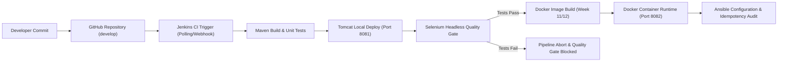

---
# Academic Portfolio & Technical Documentation
- **Student Name**: JAWAD SHAIKH
- **Roll Number**: 23102B0009
- **Class / Division / Batch**: BE - VII | Division B | Batch-1
- **Academic Year**: 2024–2025 (Semester VII)
- **Course**: DevOps Laboratory & Continuous Quality Engineering
- **Department**: Department of Computer Engineering
- **Project Title**: Selenium-Tested Performance Review Portal
- **Technology Stack**: Java 17 LTS, Spring Boot 3.3.3, PostgreSQL 16, Maven, Tomcat 10, Selenium WebDriver 4.24, Jenkins CI/CD, Docker, Ansible
---

# Week 02: Agile Planning and DevOps Workflow

> **Official Syllabus Task**:
> Create user stories and acceptance criteria for the Performance Review Portal. Prepare a product backlog, 15-week Kanban/Scrum plan, Definition of Done and a DevOps lifecycle diagram from development to operations.

> **Mandatory Deliverable**:
> Backlog, task board, sprint plan, Definition of Done and DevOps workflow diagram.

---

## 1. User Stories & Acceptance Criteria

### User Story 1 (US-01): Employee Authentication & Session Management
- **As an** Employee,  
- **I want to** securely log in to the portal using my corporate email and password,  
- **So that** I can access my confidential self-appraisal submissions and performance records.  
- **Acceptance Criteria**:
  1. System authenticates user against the `employee` database table.
  2. Successful login sets `session_user` and redirects to `/dashboard`.
  3. Invalid credentials render a high-visibility error alert: *"Invalid email or password"*.
  4. Attempting to log in with a manager credential provides an explicit prompt directing the user to Manager Login.

### User Story 2 (US-02): Self-Appraisal Form Submission
- **As an** Employee,  
- **I want to** evaluate my competencies across 4 dimensions (Technical, Communication, Teamwork, Problem-Solving) and submit text achievements and future goals,  
- **So that** my manager can objectively evaluate my contributions.  
- **Acceptance Criteria**:
  1. Competency scores are constrained to integers between 1 and 10.
  2. Overall average score is computed automatically to 2 decimal places.
  3. Form submission creates a record in `review` with status `PENDING`.
  4. Employee is redirected to `/review/history` with a success banner.

### User Story 3 (US-03): Manager Evaluation & Feedback Engine
- **As an** Engineering Manager,  
- **I want to** view pending reviews submitted by my direct reports, evaluate their performance, input constructive feedback, and approve/reject the review,  
- **So that** the employee receives formal appraisal documentation.  
- **Acceptance Criteria**:
  1. Manager dashboard displays a queue of all reviews where `status = 'PENDING'`.
  2. Manager can inspect the employee's submitted self-ratings and text achievements.
  3. Approving updates status to `APPROVED`, records `approved_date`, and stores `manager_comment`.

---

## 2. Product Backlog & Story Point Estimation

| Story ID | Module | User Story Description | Priority | Story Points | Target Sprint |
| :--- | :--- | :--- | :--- | :--- | :--- |
| **US-01** | Auth | Employee login, session validation & logout | Critical (P0) | 3 | Sprint 1 |
| **US-02** | Review | Self-appraisal form submission & rating calculation | Critical (P0) | 5 | Sprint 2 |
| **US-03** | History | Historical review ledger with status badges & filters | High (P1) | 5 | Sprint 2 |
| **US-04** | Manager | Separate Manager login & session isolation | High (P1) | 3 | Sprint 3 |
| **US-05** | Manager | Pending review evaluation queue & feedback submission | Critical (P0) | 8 | Sprint 3 |
| **US-06** | Dashboard | HR analytics summary cards & departmental averages | Medium (P2) | 5 | Sprint 3 |
| **US-07** | DevOps | Jenkins Declarative Pipeline with Maven compile | Critical (P0) | 5 | Sprint 4 |
| **US-08** | QA | Selenium WebDriver test suite (5 User Journeys) | Critical (P0) | 8 | Sprint 5 |
| **US-09** | DevOps | Quality Gate enforcement in Jenkins CI | Critical (P0) | 5 | Sprint 5 |
| **US-10** | Ops | Multi-stage Dockerization & automated container run | High (P1) | 5 | Sprint 6 |
| **US-11** | Ops | Ansible infrastructure configuration & idempotency | High (P1) | 8 | Sprint 7 |

---

## 3. 15-Week Sprint Plan & Kanban Milestones

```
Sprint 1 (Weeks 1-2)   : Scope Finalization, Agile Backlog, DevOps Architecture Setup.
Sprint 2 (Weeks 3-4)   : Spring Boot Scaffolding, PostgreSQL Schemas, Git Repo & Branch Policies.
Sprint 3 (Weeks 5-6)   : Core Feature Development, Manager Workspaces, Git Merge Conflict Demo & MVP Tag v1.0.0.
Sprint 4 (Weeks 7-8)   : Jenkins CI Setup, Declarative Jenkinsfile, Automated Tomcat 10 Deployment.
Sprint 5 (Weeks 9-10)  : Selenium Automated Testing, Failure Screenshots, Quality Gate Pipeline Enforcement.
Sprint 6 (Weeks 11-12) : Docker Multi-stage Builds, Container Lifecycle, Jenkins-Docker Continuous Deployment.
Sprint 7 (Weeks 13-14) : Ansible Playbooks, Node Provisioning, Idempotency Verification & Rollback Drills.
Sprint 8 (Week 15)     : End-to-End Release Validation, Final Master Documentation, Viva & Presentation.
```

---

## 4. Definition of Done (DoD)
A backlog user story or technical task is classified as **Done** only when:
1. **Code Cleanliness**: Code compiles cleanly with zero compilation warnings under Java 17 and Maven 3.9.
2. **Automated Unit & Integration Tests**: All JUnit 5 repository and controller tests pass with 100% success.
3. **Automated Selenium Quality Gate**: All 5 end-to-end browser journeys execute in headless mode without assertion failure.
4. **Peer Review & Version Control**: Changes merged into `develop` via GitHub Pull Request with at least one review approval.
5. **Continuous Deployment**: Build automatically deployed to Apache Tomcat / Docker container without manual intervention.

---

## 5. DevOps Lifecycle Architecture Diagram



---

## 6. Official Deliverable Sign-Off
- **Backlog**: Product backlog formulated with story point estimates.
- **Task Board & Sprint Plan**: 15-week roadmap mapped across 8 distinct sprints.
- **Definition of Done**: Standardized quality requirements instituted.
- **DevOps Workflow Diagram**: End-to-end visualization rendered and documented.
