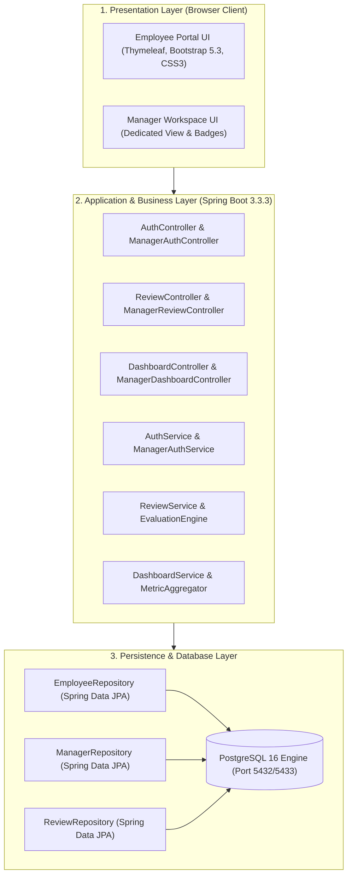
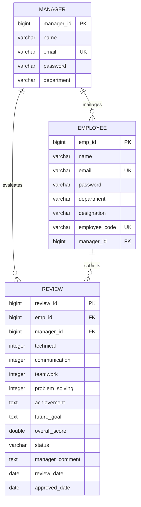

---
# Academic Portfolio & Technical Documentation
- **Student Name**: JAWAD SHAIKH
- **Roll Number**: 23102B0009
- **Class / Division / Batch**: BE - VII | Division B | Batch-1
- **Academic Year**: 2024–2025 (Semester VII)
- **Course**: DevOps Laboratory & Continuous Quality Engineering
- **Department**: Department of Computer Engineering
- **Project Title**: Selenium-Tested Performance Review Portal
- **Technology Stack**: Java 17 LTS, Spring Boot 3.3.3, PostgreSQL 16, Maven, Tomcat 10, Selenium WebDriver 4.24, Jenkins CI/CD, Docker, Ansible
---

# Week 03: Requirements, Architecture and Technology Setup

> **Official Syllabus Task**:
> Design the minimum application architecture for the Performance Review Portal. The MVP should cover create, view, update and search records; role-based status workflow; summary dashboard. Select the programming stack, Maven/Gradle/Ant build tool, database if required, Tomcat/Nginx deployment target and local development setup.

> **Mandatory Deliverable**:
> SRS summary, use-case diagram, architecture diagram, data model/API list and working local setup.

---

## 1. Software Requirements Specification (SRS) Summary

### Functional Requirements (FR):
- **FR-01 (Authentication)**: Support role-based credential verification for `EMPLOYEE` and `MANAGER` accounts.
- **FR-02 (Review Creation)**: Enable employees to input ratings (1–10) across four core metrics and submit qualitative achievements.
- **FR-03 (Scoring Algorithm)**: Compute unweighted composite average score dynamically:
  $$\text{Overall Score} = \frac{\text{Technical} + \text{Communication} + \text{Teamwork} + \text{Problem Solving}}{4}$$
- **FR-04 (Lifecycle Workflow)**: Enforce transition state machine: $\text{PENDING} \rightarrow \text{APPROVED}$ or $\text{REJECTED}$.
- **FR-05 (Search & Filter)**: Filter reviews by employee ID, manager ID, and status badge (`PENDING`, `APPROVED`).

### Non-Functional Requirements (NFR):
- **NFR-01 (Performance)**: Page render and API response latency under 200ms on local staging.
- **NFR-02 (Resilience & Idempotency)**: Auto-seeding database runner guarantees demo accessibility on fresh boots.
- **NFR-03 (Portability)**: WAR packaged application runs interchangeably on standalone Apache Tomcat 10 and containerized Alpine Linux.

---

## 2. System Architecture (3-Tier Layered Architecture)

---

## 3. Data Model & Entity Relationship (ER) Schema

---

## 4. REST & MVC API Endpoints Catalog

| HTTP Method | Route Endpoint | Controller Handler | Purpose & Access Control |
| :--- | :--- | :--- | :--- |
| `GET` | `/login` | `AuthController.showLoginForm()` | Render employee sign-in page |
| `POST` | `/login` | `AuthController.processLogin()` | Authenticate employee credentials |
| `GET` | `/dashboard` | `DashboardController.showDashboard()` | Employee metrics & quick actions |
| `GET` | `/review` | `ReviewController.showReviewForm()` | Render self-appraisal form |
| `POST` | `/review` | `ReviewController.submitReview()` | Process self-appraisal submission |
| `GET` | `/review/history` | `ReviewController.showReviewHistory()` | View submitted review records |
| `GET` | `/manager-login` | `ManagerAuthController.showManagerLoginForm()` | Conflict-free Manager login view |
| `POST` | `/manager-login` | `ManagerAuthController.processManagerLogin()` | Authenticate Manager session |
| `GET` | `/manager/dashboard`| `ManagerDashboardController.showManagerDashboard()` | Manager queue & statistics |
| `POST` | `/manager/review/{id}/evaluate` | `ManagerReviewController.evaluateReview()` | Approve/Reject & comment |

---

## 5. Working Local Development Setup Verification
- **JDK Version**: Java 17 LTS (`openjdk version "17.0.7"`).
- **Build System**: Apache Maven 3.9+ verified via `mvn -v`.
- **Database**: PostgreSQL 16 active on port `5432` (`performance_review`).
- **Application Server**: Apache Tomcat 10.1 configured on port `8081`.

---

## 6. Official Deliverable Sign-Off
- **SRS Summary**: Core functional and non-functional requirements compiled.
- **Use-Case & Architecture Diagrams**: System interactions and 3-tier structure visualized.
- **Data Model & API Catalog**: Schemas, keys, and endpoints specified.
- **Working Local Setup**: Runtime dependencies confirmed operational.
