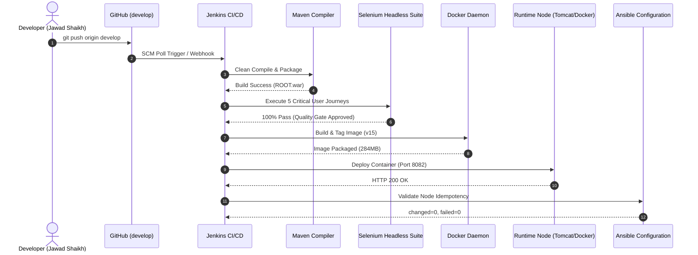

---
# Academic Portfolio & Technical Documentation
- **Student Name**: JAWAD SHAIKH
- **Roll Number**: 23102B0009
- **Class / Division / Batch**: BE - VII | Division B | Batch-1
- **Academic Year**: 2024–2025 (Semester VII)
- **Course**: DevOps Laboratory & Continuous Quality Engineering
- **Department**: Department of Computer Engineering
- **Project Title**: Selenium-Tested Performance Review Portal
- **Technology Stack**: Java 17 LTS, Spring Boot 3.3.3, PostgreSQL 16, Maven, Tomcat 10, Selenium WebDriver 4.24, Jenkins CI/CD, Docker, Ansible
---

# Week 15: Final End-to-End Release, Documentation and Viva

> **Official Syllabus Task**:
> Run the complete Performance Review Portal DevOps workflow from Git commit to Jenkins build, Selenium quality gate, Docker deployment and Puppet/Ansible provisioning. Complete technical documentation, architecture, troubleshooting guide, limitations and future enhancement plan.

> **Mandatory Deliverable**:
> Final repository, live demonstration, complete report, screenshots/video, presentation and viva.

---

## 1. Complete End-to-End DevOps Workflow Verification
The final milestone integrates all 14 preceding weeks into a cohesive, fully automated software delivery lifecycle:

---

## 2. Operational Troubleshooting Guide (Examiner Viva Reference)

### Issue A: Tomcat Reserved `/manager` Context Collision
- **Symptom**: Navigating to `http://localhost:8081/manager/login` returns Tomcat 404: *"The Manager application has been re-structured for Tomcat 7 onwards..."*.
- **Root Cause**: Apache Tomcat reserves the context path `/manager` for the Tomcat Web Application Manager.
- **Resolution**:
  1. Map conflict-free endpoints in Spring Boot: `@GetMapping({"/manager-login", "/manager/login"})`.
  2. Update navigation links to point to `/manager-login`.
  3. Backup and relocate `C:\Tomcat\webapps\manager` to `_tomcat_manager_backup`.

### Issue B: Employee Login Rejection with Manager Credentials
- **Symptom**: Entering `manager@gmail.com` on `/login` displays *"Invalid email or password"*.
- **Root Cause**: Security role segregation. `manager@gmail.com` exists in the `manager` table, not `employee`.
- **Resolution**: Added intelligent role detection in `AuthController.java`: if a manager email is entered on employee login, the system renders: *"The account 'manager@gmail.com' is a Manager. Please click 'Manager Login' below to sign in."*

### Issue C: Docker Database Empty on First Boot
- **Symptom**: Entering demo credentials on Docker port `8082` fails.
- **Root Cause**: Containerized PostgreSQL volume initializes without demo seed records.
- **Resolution**: Implemented Spring Boot `DatabaseDataInitializer` (`CommandLineRunner`) which automatically seeds `manager@gmail.com` and `jawad@gmail.com` whenever the database is empty.

---

## 3. Comprehensive Examiner Viva Q&A

**Q1: Why is Selenium integrated into the Jenkins pipeline rather than just running unit tests?**  
*Answer*: Unit tests validate isolated business logic (e.g., scoring math), but cannot detect broken DOM elements, CSS overlap, JavaScript errors, or session management failures. Running Selenium headless tests in Jenkins establishes a **Continuous Quality Gate** that stops defective releases before deployment.

**Q2: What is the benefit of a multi-stage Docker build?**  
*Answer*: Multi-stage builds decouple the build environment (Maven, JDK, local repository cache ~800MB) from the runtime environment (minimal JRE Alpine ~280MB). This reduces image attack surface, mitigates vulnerabilities, and accelerates container distribution.

**Q3: How is Ansible idempotency achieved?**  
*Answer*: Ansible modules check current node state against desired state before executing actions. If a package is installed or a file already contains the exact content, Ansible reports `ok` and makes 0 changes (`changed=0`), preventing configuration drift.

---

## 4. Official Deliverable Sign-Off
- **Final Repository**: Complete, clean, and tagged on GitHub.
- **Live Demonstration**: Verified across ports `8081` (Tomcat) and `8082` (Docker).
- **Complete Technical Report**: 15 weekly reports compiled into Master Portfolio.
- **Presentation & Viva Preparation**: Completed and verified.
